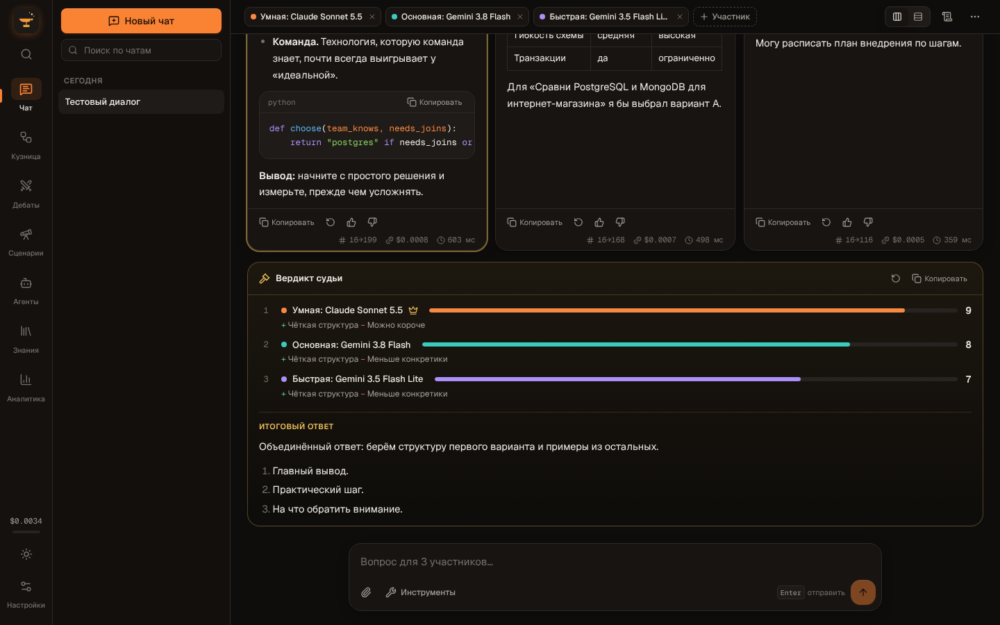
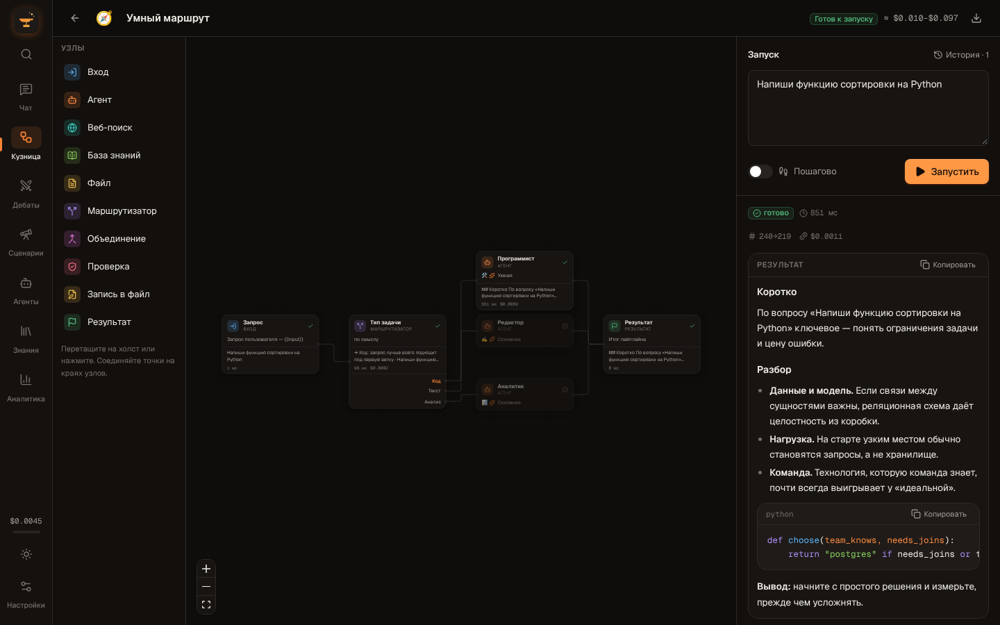
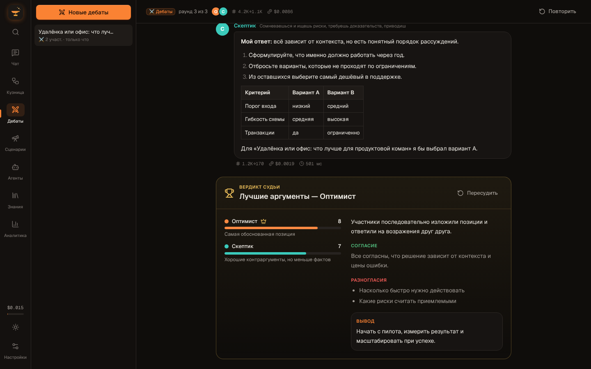
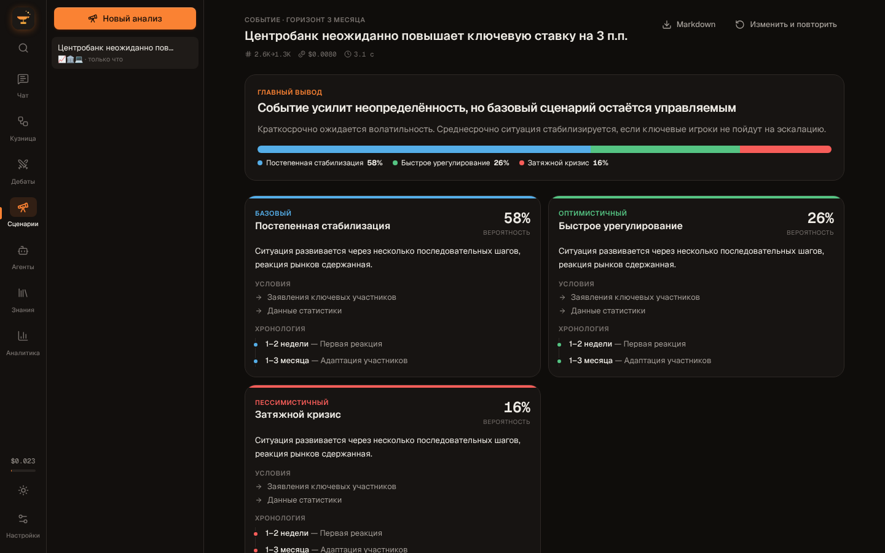

# Hephaestus — кузница ИИ-агентов

Локальная мастерская, где несколько языковых моделей работают вместе: отвечают на один вопрос параллельно, спорят друг с другом, проходят по визуальному конвейеру из агентов и проверок и разбирают события по сценариям. Модели берутся из [OpenRouter](https://openrouter.ai) (сотни облачных моделей по одному ключу), из [Ollama](https://ollama.com) (бесплатно и приватно на вашем компьютере) или с любого OpenAI-совместимого сервера.



## Что умеет

**Чат сравнения.** Один вопрос отправляется сразу нескольким участникам: моделям, агентам или пайплайнам. Ответы приходят параллельно и показываются колонками. Судья ранжирует их и собирает итоговый ответ из сильных сторон каждого. У каждого участника своя история диалога, длинные диалоги обрезаются по бюджету токенов. Есть инструменты (поиск в сети, файлы, база знаний, навыки), вложения и рассуждения reasoning-моделей.

**Кузница — визуальные пайплайны.** На холсте собирается граф из узлов: вход, агент, веб-поиск, база знаний, файл, маршрутизатор, объединение, проверка, запись в файл, результат. Независимые ветки выполняются параллельно. Маршрутизатор выбирает одну ветку, остальные пропускаются. Проверка оценивает ответ по критериям и отправляет агентов на доработку с замечаниями. Перед запуском показывается оценка стоимости. Запускать можно сразу целиком или пошагово, после запуска видна хронология выполнения узлов. В комплекте 7 шаблонов, а любой пайплайн можно позвать в чат как обычную модель.



**Дебаты.** Четыре формата: дебаты, мозговой штурм, совет экспертов, автор и критики. Участникам задаются роли, модели и число раундов. Между раундами можно вмешаться с репликой. В конце судья выносит вердикт: оценки, согласие, разногласия и вывод.



**Сценарный анализ.** Опишите событие. Модель соберёт факты в сети, отраслевые аналитики (политика, экономика, безопасность, технологии и другие) разберут его параллельно, а синтез выдаст сценарии с вероятностями, хронологией, картой последствий, сигналами для наблюдения и рекомендациями. Отчёт экспортируется в Markdown.



**Агенты и навыки.** 14 встроенных агентов: аналитик, исследователь, критик, синтезатор, программист, ревьюер кода, аудитор безопасности, тестировщик, факт-чекер и другие. Можно создавать своих. Навыки — это инструкции в `skills/<id>/SKILL.md`, модель загружает подходящую сама.

**Знания и файлы.** Локальный поиск BM25 по вашим документам с учётом русской морфологии, без эмбеддингов и платных API. Файловые инструменты ИИ работают только в выбранной рабочей папке, там же лежит встроенный редактор.

**Работа с проектом.** Модели читают, правят, перемещают и удаляют файлы вашего проекта, ищут по коду, запускают тесты и сборку в терминале. Несколько моделей могут проверять проект параллельно с общим сводным отчётом или править его каждая в своей копии — вы сравниваете diff и применяете лучшее. Подробнее — в разделе «Работа с проектом».

**Аналитика и лимиты.** Стоимость каждого вызова берётся из ответа провайдера, а не из оценки. Расходы видны по дням, моделям и разделам. Дневной и месячный лимиты блокируют запросы при превышении. Историю можно выгрузить в CSV или JSON.

Ещё: светлая и тёмная темы, командная палитра (<kbd>Ctrl</kbd>+<kbd>K</kbd>), мобильная вёрстка, резервная копия всех данных одним файлом.

## Быстрый старт

Нужны Node.js 20.9+ и pnpm.

```bash
pnpm install
```

```bash
pnpm dev
```

Откройте http://127.0.0.1:3000 → **Настройки** → вставьте ключ OpenRouter или запустите Ollama. Ключ можно задать и в `.env` (образец — `.env.example`):

```bash
cp .env.example .env
```

Для локальных моделей:

```bash
ollama pull qwen3:8b
```

Модель появится в каталоге как `ollama/qwen3:8b`.

### Роли моделей

Агенты, шаблоны и судьи ссылаются не на конкретные модели, а на роли: **Умная**, **Основная** и **Быстрая**. По умолчанию роль сама берёт самую свежую модель подходящего семейства из каталога OpenRouter (Claude Sonnet, Gemini Flash, Flash Lite), а если ключа нет, то первую модель Ollama. В настройках роль можно закрепить за любой моделью, и замена применится везде сразу.

## Работа с проектом

**1. Рабочая папка.** Настройки → **Рабочая папка и терминал** → укажите абсолютный путь к папке проекта (например `/home/me/projects/shop` или `C:\Projects\shop`). Без настройки используется `workspace/` рядом с приложением или `HEPHAESTUS_WORKSPACE` из `.env`. Файловые инструменты не выходят за пределы этой папки.

**2. Терминал.** Там же переключите терминал в «Полный доступ». Модели смогут выполнять любые команды в рабочей папке с вашими правами: тесты, линтеры, сборку, `git`, установку зависимостей, запуск программ. Долгие процессы (dev-сервер, watch) модель запускает в фоне и читает их вывод. У каждой команды есть лимит времени (по умолчанию 120 с), по его истечении процесс убивается вместе с дочерними. Ключи и токены из окружения сервера в команды не попадают.

**3. Инструменты в чате.** Включите в поле ввода наборы **Чтение файлов**, **Запись файлов**, **Поиск в коде** и **Терминал** или выберите агента — у «Программиста», «Ревьюера кода», «Аудитора безопасности» и «Тестировщика» они уже настроены. Для работы с кодом модель по умолчанию может сделать до 30 шагов с инструментами.

| Набор | Инструменты |
|---|---|
| Чтение файлов | `list_files` (по подпапке и глубине), `read_file` (с номерами строк и диапазоном) |
| Запись файлов | `write_file`, `edit_file` (точечная замена, `replace_all`), `move_file`, `delete_file`, `remember` |
| Поиск в коде | `search_code` (регулярные выражения, ripgrep при наличии), `find_files` (маски `src/**/*.ts`), `codebase_search` (поиск по описанию) |
| Терминал | `run_command`, `start_process`, `process_output`, `stop_process`, `git_clone` |

**Поиск в коде** устроен как у агентов-программистов: точный поиск по тексту (ripgrep — установите `rg`, на больших проектах это в разы быстрее) плюс поиск по смыслу. Второй — это BM25 по фрагментам кода, где идентификаторы разобраны на слова (`getUserById` → get user by id), а путь к файлу — часть фрагмента. Индекс живёт в памяти и обновляется только по изменённым файлам. Векторные эмбеддинги не нужны: на коде лексический поиск по идентификаторам и grep работают быстро, бесплатно и без отдельной модели.

**4. Проверка несколькими моделями.** Пресет чата **Проверка кода** — ревьюер, аудитор безопасности и тестировщик параллельно изучают проект, кнопка **Сравнить ответы** собирает общий отчёт. Шаблон Кузницы **Проверка проекта командой** делает то же самое и сохраняет сводный отчёт в `reviews/team-review.md`; синтезатор перепроверяет спорные находки по коду. Проверяющие файлы не меняют, поэтому работают с оригиналом одновременно.

**5. Правки несколькими моделями.** Пресет **Правки командой** или меню чата → **Своя копия проекта у каждого**. Каждый участник правит свою копию проекта (с незакоммиченными изменениями; `node_modules` и `.venv` подключаются ссылкой, поэтому тесты работают), так что модели не затирают правки друг друга. Под каждым ответом — изменённые файлы, diff и кнопки **Применить к проекту** и **Удалить копию**. Судья сравнивает и сами правки. Файлы, которые вы изменили в проекте после создания копии, при применении не перезаписываются, а показываются как конфликт.

**6. Память и контекст.** Файл `HEPHAESTUS.md` (или `AGENTS.md`, `CLAUDE.md`) в корне рабочей папки автоматически подключается к запросам моделей, работающих с проектом: опишите там команды сборки и тестов, правила и договорённости. Модель сама дописывает туда важное инструментом `remember`. Когда диалог перестаёт помещаться в контекст, ранние ходы сжимаются в резюме (решения, изменённые файлы, команды, что осталось сделать). Вручную — меню чата или команды `/compact` (сжать) и `/clear` (очистить контекст: история остаётся на экране, модели начинают с чистого листа).

**7. Общая папка инструментов `@tools`.** Утилиты, которые модели скачивают для работы, лежат в одной папке на все проекты, копии и рабочие папки (`data/tools`, путь меняется переменной `HEPHAESTUS_TOOLS`). Инструмент `git_clone` кладёт туда репозитории (`@tools/repos/<имя>`; повторный вызов подтягивает обновления, а не качает заново), `npm i -g` ставит пакеты туда же, а `@tools/bin` и общее Python-окружение `@tools/venv` уже в `PATH` команд. Файловые инструменты и поиск понимают пути `@tools/…`. Модель знает об этом из системного промпта, поэтому просьба «возьми https://github.com/owner/tool и просканируй им проект, составь отчёт» выполняется целиком: клонирование, сборка, запуск, отчёт по реальному выводу.

**8. Память сессии.** Результаты инструментов (прочитанный код, вывод команд) в следующие ходы не передаются — иначе контекст переполнится за пару ходов. Поэтому модель с инструментами записывает важное (места в коде, выводы, план) инструментом `session_note` в память диалога, а она подключается к каждому следующему запросу этого диалога. Меню чата → **Память сессии**: посмотреть и поправить записи, перенести их (вместе с выжимкой последних ходов) в другой или новый диалог.

## Пайплайны: узлы и переменные

| Узел | Что делает |
|---|---|
| Вход | Запрос, с которым запускают пайплайн |
| Агент | Вызов модели или агента из библиотеки: свой промпт, инструменты, JSON-режим, повторы и запасные модели |
| Веб-поиск | Ищет в сети и при желании читает первые страницы выдачи |
| База знаний | Достаёт релевантные фрагменты из ваших документов |
| Файл / Запись в файл | Читает или пишет файл в `workspace/` |
| Маршрутизатор | Выбирает одну ветку по смыслу (модель) или по ключевым словам |
| Объединение | Склеивает входы по шаблону без вызова модели |
| Проверка | Оценивает ответ по критериям и возвращает его агентам на доработку |
| Результат | Итог пайплайна |

В промптах и путях доступны переменные: `{{input}}` — исходный запрос, `{{prev}}` — выходы входящих узлов, `{{Название узла}}` — выход конкретного узла.

## Как устроено

```
app/                 страницы (Next.js App Router) и API
  api/llm            единый потоковый шлюз к моделям (NDJSON)
  api/tools          прямой вызов инструментов для узлов пайплайна
  api/sandboxes      копии проекта для параллельных правок
  api/models|status|settings|workspace|knowledge|skills
proxy.ts             API отвечает только на запросы к localhost
lib/
  engine/            движки без привязки к UI: pipeline, debate, scenario, chat, шаблоны
  server/            шлюз LLM с циклом инструментов, каталог, песочница, поиск, BM25, навыки
  client/            запуск движков из браузера, лимиты, учёт расходов
  stores/            состояние в IndexedDB (zustand)
components/          интерфейс по разделам и общие UI-компоненты
skills/              навыки (SKILL.md)
workspace/           рабочая папка по умолчанию (не в git)
data/                ключи, индекс знаний и копии проектов на сервере (не в git)
tests/               тесты движков, сервера и утилит (vitest)
```

Все провайдеры говорят на OpenAI-совместимом API, поэтому клиент один. Цикл «модель → инструмент → модель» выполняется на сервере, а в браузер приходят события: текст, рассуждения, вызовы инструментов, расход. Движки пайплайнов, дебатов и сценариев — чистые функции с внедряемым вызовом модели, их тесты обходятся без сети.

## Безопасность

Приложение рассчитано на локальный запуск и слушает только `127.0.0.1`.

- Ключи хранятся на сервере (`data/settings.json` или `.env`) и в браузер не передаются.
- Файловые инструменты не выходят за пределы рабочей папки — ни через `..`, ни через символические ссылки.
- Терминал по умолчанию выключен. В режиме «Полный доступ» команды выполняются с правами вашего пользователя: начинаются в рабочей папке, но могут обратиться к любым файлам компьютера. Ключи и токены из окружения в команды не передаются, явно катастрофические команды (`rm -rf /`, `mkfs`, выключение компьютера) отклоняются — но это защита от случайностей, а не песочница. Не давайте терминал вместе с интернетом моделям, которым не доверяете: прочитанная страница может подсказать вредную команду.
- API отвечает только на запросы, адресованные `localhost` (защита от DNS rebinding). Для доступа из локальной сети перечислите имена хостов в `HEPHAESTUS_ALLOWED_HOSTS`.
- Чтение страниц не пускает модель в локальную сеть: веб-страница с prompt injection не сможет обратиться к API самого приложения.
- API отклоняет запросы с чужих сайтов: открытая в браузере вкладка не может дёргать `localhost`.

## Разработка

```bash
pnpm check
```

Это проверка типов и тесты (vitest; тесты работают во временных папках и не трогают ваши `data/` и рабочую папку). Сборка — `pnpm build`.

Без ключа можно работать с заглушкой модели: она отвечает правдоподобным текстом и нужными JSON-форматами.

```bash
HEPHAESTUS_MOCK_LLM=1 pnpm dev
```

## Что изменилось в 2.0

Проект переписан с нуля, идея сохранена: несколько моделей работают вместе. Исправлено:

- **Двойная оплата.** Каждый запрос в чат уходил в OpenRouter дважды.
- **Сжатие контекста и «умное чтение» файлов не работали:** они ждали JSON, а API отдавал поток.
- **Симулятор событий** обращался к API по относительному адресу с сервера и не мог работать.
- **Цены** считались по грубой оценке. Теперь используется реальная стоимость из ответа провайдера.
- **Файлы.** ИИ мог переписывать исходники самого приложения. Теперь он работает только в `workspace/`.
- **Хранилище.** Данные хранились в localStorage, который переполняется. Теперь в IndexedDB с отложенной записью.
- **Интерфейс** был смесью русского и английского, теперь полностью на русском.

Telegram-бот, интеграции (Slack, Notion, Trello, почта), триггеры и мультимодальные экраны убраны: они почти не были связаны с ядром. Их роль выполняют инструменты (поиск, файлы, знания, навыки), к которым легко добавить новые. Данные версии 1.x (localStorage `arena-storage`) не переносятся.
