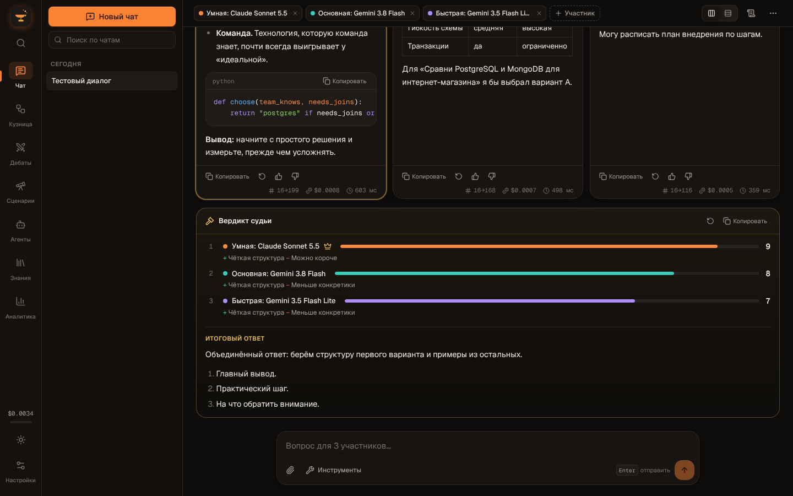
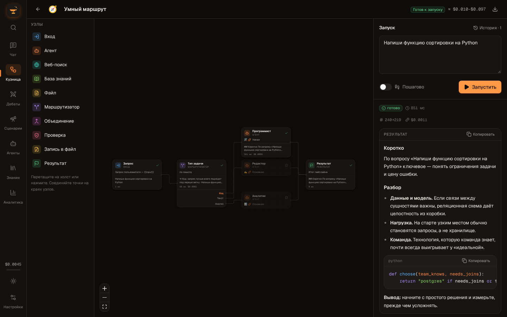
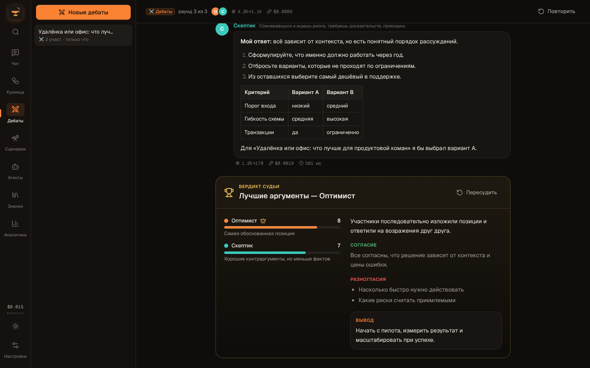
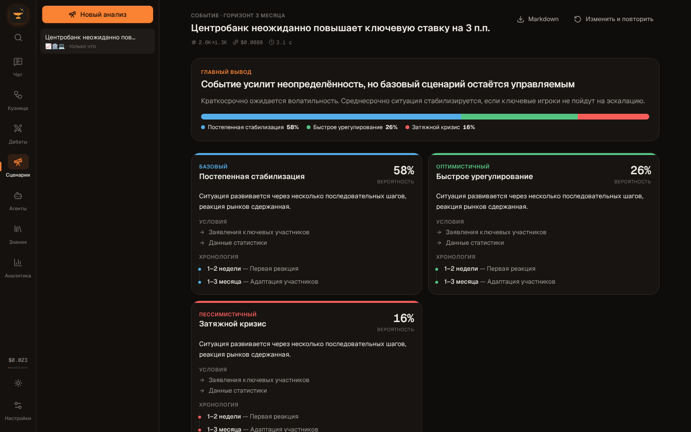

# Hephaestus — кузница ИИ-агентов

Локальная мастерская, где несколько языковых моделей работают вместе: отвечают на один вопрос параллельно, спорят друг с другом, проходят по визуальному конвейеру из агентов и проверок и разбирают события по сценариям. Модели берутся из [OpenRouter](https://openrouter.ai) (сотни облачных моделей по одному ключу), из [Ollama](https://ollama.com) (бесплатно и приватно на вашем компьютере) или с любого OpenAI-совместимого сервера.



## Что умеет

**Чат сравнения.** Один вопрос отправляется сразу нескольким участникам: моделям, агентам или пайплайнам. Ответы приходят параллельно и показываются колонками. Судья ранжирует их и собирает итоговый ответ из сильных сторон каждого. У каждого участника своя история диалога, длинные диалоги обрезаются по бюджету токенов. Есть инструменты (поиск в сети, файлы, база знаний, навыки), вложения и рассуждения reasoning-моделей.

**Кузница — визуальные пайплайны.** На холсте собирается граф из узлов: вход, агент, веб-поиск, база знаний, файл, маршрутизатор, объединение, проверка, запись в файл, результат. Независимые ветки выполняются параллельно. Маршрутизатор выбирает одну ветку, остальные пропускаются. Проверка оценивает ответ по критериям и отправляет агентов на доработку с замечаниями. Перед запуском показывается оценка стоимости. Запускать можно сразу целиком или пошагово, после запуска видна хронология выполнения узлов. В комплекте 7 шаблонов, а любой пайплайн можно позвать в чат как обычную модель.



**Дебаты.** Четыре формата: дебаты, мозговой штурм, совет экспертов, автор и критики. Участникам задаются роли, модели и число раундов. Между раундами можно вмешаться с репликой. В конце судья выносит вердикт: оценки, согласие, разногласия и вывод.



**Сценарный анализ.** Опишите событие. Модель соберёт факты в сети, отраслевые аналитики (политика, экономика, безопасность, технологии и другие) разберут его параллельно, а синтез выдаст сценарии с вероятностями, хронологией, картой последствий, сигналами для наблюдения и рекомендациями. Отчёт экспортируется в Markdown.



**Агенты и навыки.** 11 встроенных агентов: аналитик, исследователь, критик, синтезатор, программист, факт-чекер и другие. Можно создавать своих. Навыки — это инструкции в `skills/<id>/SKILL.md`, модель загружает подходящую сама.

**Знания и файлы.** Локальный поиск BM25 по вашим документам с учётом русской морфологии, без эмбеддингов и платных API. Файловые инструменты ИИ работают только в папке `workspace/`, там же лежит встроенный редактор.

**Аналитика и лимиты.** Стоимость каждого вызова берётся из ответа провайдера, а не из оценки. Расходы видны по дням, моделям и разделам. Дневной и месячный лимиты блокируют запросы при превышении. Историю можно выгрузить в CSV или JSON.

Ещё: светлая и тёмная темы, командная палитра (<kbd>Ctrl</kbd>+<kbd>K</kbd>), мобильная вёрстка, резервная копия всех данных одним файлом.

## Быстрый старт

Нужны Node.js 20.9+ и pnpm.

```bash
pnpm install
```

```bash
pnpm dev
```

Откройте http://127.0.0.1:3000 → **Настройки** → вставьте ключ OpenRouter или запустите Ollama. Ключ можно задать и в `.env` (образец — `.env.example`):

```bash
cp .env.example .env
```

Для локальных моделей:

```bash
ollama pull qwen3:8b
```

Модель появится в каталоге как `ollama/qwen3:8b`.

### Роли моделей

Агенты, шаблоны и судьи ссылаются не на конкретные модели, а на роли: **Умная**, **Основная** и **Быстрая**. По умолчанию роль сама берёт самую свежую модель подходящего семейства из каталога OpenRouter (Claude Sonnet, Gemini Flash, Flash Lite), а если ключа нет, то первую модель Ollama. В настройках роль можно закрепить за любой моделью, и замена применится везде сразу.

## Пайплайны: узлы и переменные

| Узел | Что делает |
|---|---|
| Вход | Запрос, с которым запускают пайплайн |
| Агент | Вызов модели или агента из библиотеки: свой промпт, инструменты, JSON-режим, повторы и запасные модели |
| Веб-поиск | Ищет в сети и при желании читает первые страницы выдачи |
| База знаний | Достаёт релевантные фрагменты из ваших документов |
| Файл / Запись в файл | Читает или пишет файл в `workspace/` |
| Маршрутизатор | Выбирает одну ветку по смыслу (модель) или по ключевым словам |
| Объединение | Склеивает входы по шаблону без вызова модели |
| Проверка | Оценивает ответ по критериям и возвращает его агентам на доработку |
| Результат | Итог пайплайна |

В промптах и путях доступны переменные: `{{input}}` — исходный запрос, `{{prev}}` — выходы входящих узлов, `{{Название узла}}` — выход конкретного узла.

## Как устроено

```
app/                 страницы (Next.js App Router) и API
  api/llm            единый потоковый шлюз к моделям (NDJSON)
  api/tools          прямой вызов инструментов для узлов пайплайна
  api/models|status|settings|workspace|knowledge|skills
lib/
  engine/            движки без привязки к UI: pipeline, debate, scenario, chat, шаблоны
  server/            шлюз LLM с циклом инструментов, каталог, песочница, поиск, BM25, навыки
  client/            запуск движков из браузера, лимиты, учёт расходов
  stores/            состояние в IndexedDB (zustand)
components/          интерфейс по разделам и общие UI-компоненты
skills/              навыки (SKILL.md)
workspace/           песочница файловых инструментов (не в git)
data/                ключи и индекс знаний на сервере (не в git)
tests/               тесты движков, сервера и утилит (vitest)
```

Все провайдеры говорят на OpenAI-совместимом API, поэтому клиент один. Цикл «модель → инструмент → модель» выполняется на сервере, а в браузер приходят события: текст, рассуждения, вызовы инструментов, расход. Движки пайплайнов, дебатов и сценариев — чистые функции с внедряемым вызовом модели, их тесты обходятся без сети.

## Безопасность

Приложение рассчитано на локальный запуск и слушает только `127.0.0.1`.

- Ключи хранятся на сервере (`data/settings.json` или `.env`) и в браузер не передаются.
- Файловые инструменты не выходят за пределы `workspace/` — ни через `..`, ни через символические ссылки.
- Чтение страниц не пускает модель в локальную сеть: веб-страница с prompt injection не сможет обратиться к API самого приложения.
- API отклоняет запросы с чужих сайтов: открытая в браузере вкладка не может дёргать `localhost`.

## Разработка

```bash
pnpm check
```

Это проверка типов и 41 тест. Сборка — `pnpm build`.

Без ключа можно работать с заглушкой модели: она отвечает правдоподобным текстом и нужными JSON-форматами.

```bash
HEPHAESTUS_MOCK_LLM=1 pnpm dev
```

## Что изменилось в 2.0

Проект переписан с нуля, идея сохранена: несколько моделей работают вместе. Исправлено:

- **Двойная оплата.** Каждый запрос в чат уходил в OpenRouter дважды.
- **Сжатие контекста и «умное чтение» файлов не работали:** они ждали JSON, а API отдавал поток.
- **Симулятор событий** обращался к API по относительному адресу с сервера и не мог работать.
- **Цены** считались по грубой оценке. Теперь используется реальная стоимость из ответа провайдера.
- **Файлы.** ИИ мог переписывать исходники самого приложения. Теперь он работает только в `workspace/`.
- **Хранилище.** Данные хранились в localStorage, который переполняется. Теперь в IndexedDB с отложенной записью.
- **Интерфейс** был смесью русского и английского, теперь полностью на русском.

Telegram-бот, интеграции (Slack, Notion, Trello, почта), триггеры и мультимодальные экраны убраны: они почти не были связаны с ядром. Их роль выполняют инструменты (поиск, файлы, знания, навыки), к которым легко добавить новые. Данные версии 1.x (localStorage `arena-storage`) не переносятся.
